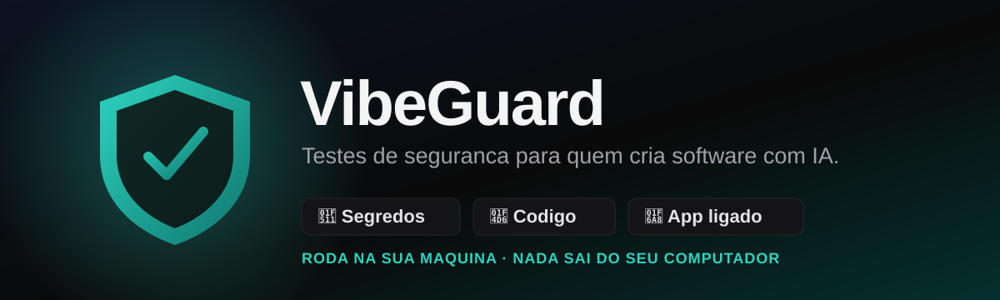

<a id="topo"></a>

<p align="center">
  
</p>

# 🛡️ VibeGuard

**Testes de segurança para quem cria software com IA.**

O VibeGuard roda **na sua própria máquina**, procura brechas no seu projeto e explica
cada uma em linguagem simples, já com a correção pronta. **Nenhum arquivo seu é
enviado para fora.** Você aponta a pasta (ou o app rodando); ele faz o resto.

<p align="center">
  <a href="#começar-em-dois-cliques"><strong>COMEÇAR →</strong></a>
  &nbsp; · &nbsp;
  <a href="#o-que-ele-faz">O QUE ELE FAZ</a>
  &nbsp; · &nbsp;
  <a href="docs/guia-visual.html">GUIA VISUAL</a>
  &nbsp; · &nbsp;
  <a href="#uso-responsável">USO RESPONSÁVEL</a>
</p>

<p align="center">
  <a href=".github/workflows/ci.yml"></a>
  &nbsp;
  <a href="LICENSE"><strong>MIT</strong></a>
</p>

<p align="center">
  <strong>Next.js 16</strong> + TypeScript · roda local no navegador · sem servidor, sem cadastro
</p>

---

## ⚠️ Uso responsável

O VibeGuard só pode ser usado para testar **software que é seu** (ou que você tem
permissão explícita para testar). O teste do app em execução funciona apenas em
endereços da **sua própria máquina** (`localhost`) — a ferramenta recusa qualquer
outro endereço de propósito, e nunca derruba nem tenta forçar senha. Testar o
sistema de terceiros sem autorização é crime.

---

## Começar em dois cliques

**Pré-requisito:** instale o [Node.js](https://nodejs.org) (versão 20 ou mais nova).

1. Baixe este projeto (botão verde **Code → Download ZIP**, e descompacte).
2. Abra o programa:
   - **Windows:** dê dois cliques em **`iniciar.bat`**.
   - **Mac / Linux:** rode `./iniciar.sh` no terminal.

O script instala o que falta e inicia o VibeGuard. Quando aparecer
`http://localhost:3000`, abra no navegador.

Prefere comandos?

```bash
pnpm install   # instala as dependências (use "corepack enable" se faltar o pnpm)
pnpm dev       # abre em http://localhost:3000
```

---

## O que ele faz

Três "detetives" trabalham juntos, da leitura do código ao teste do app ligado:

| Detetive | O que procura | Precisa do app ligado? |
|---|---|---|
| 🔑 **Segredos** | Chaves de API, tokens e chaves privadas esquecidas no código | Não |
| 📖 **Código** | Descuidos que abrem brecha: XSS, `eval`, SQL mal montado, CORS liberado, segredo em variável pública | Não |
| 🚨 **App ligado** | Testa o app rodando: travas de segurança faltando, arquivo sensível exposto, rota sem login, entrada refletida (XSS) | Sim (em `localhost`) |

Cada achado traz **o que é**, **a gravidade** (crítica → baixa), **onde está**, uma
**explicação simples** e a **correção pronta pra copiar** — inclusive um texto para
colar na sua ferramenta de IA.

> O VibeGuard é um ótimo primeiro pente-fino, **não** uma garantia: uma brecha nova
> sempre pode escapar. Vale sempre um olhar humano no fim.

---

## Como usar

Na tela, há duas seções:

1. **Analisar o código** — informe o caminho da pasta do seu projeto. O VibeGuard lê
   os arquivos (ignorando `node_modules`, builds e binários) e aponta segredos e
   descuidos.
2. **Testar o app ligado** — deixe o seu app rodando e informe o endereço local
   (ex.: `localhost:3000`). O teste é **forte, porém não destrutivo**.

Um guia visual para quem não é técnico está em
[`docs/guia-visual.html`](docs/guia-visual.html).

---

## Como funciona (por dentro)

- **Local-first:** o servidor Next.js roda na sua máquina e lê os arquivos ali mesmo;
  o navegador recebe só o relatório, com os segredos **mascarados**.
- **Privacidade:** nada é enviado para servidores externos; os logs nunca registram
  caminho, conteúdo de arquivo ou segredo.
- **Não destrutivo:** o teste do app só usa requisições de leitura, em pouca
  quantidade e com limite de tempo — sem força bruta, sem negação de serviço.

Detalhes de arquitetura em [`docs/architecture.md`](docs/architecture.md).

---

## Para desenvolver

| Comando | O que faz |
|---|---|
| `pnpm dev` | Inicia em modo desenvolvimento |
| `pnpm test` | Testes (Vitest) |
| `pnpm check` | Verificação completa: lint, tipos, regras, testes e build |

A cada mudança, o [GitHub Actions](.github/workflows/ci.yml) roda `pnpm check` no
Linux e no Windows.

### Documentação

- [Produto e escopo](PRODUCT.md)
- [Preparação local](docs/onboarding.md)
- [Arquitetura e decisões](docs/architecture.md)
- [Design e acessibilidade](docs/design.md)
- [Qualidade e checks](docs/quality.md)
- [Setup e evidências](docs/setup.md)
- [Instruções para agentes](AGENTS.md)

---

## Licença e créditos

Sob a licença [MIT](LICENSE) — livre para usar, estudar e compartilhar, sem
garantias e apenas em sistemas que você tem permissão para testar.

Base criada com o [Vibe Coding Toolkit](https://github.com/soumatheusgomes/vibe-coding-toolkit).

<p align="center">
  <strong>TESTE O SEU. CONSERTE ANTES.</strong>
  <br />
  <a href="#topo">Voltar ao topo ↑</a>
</p>
